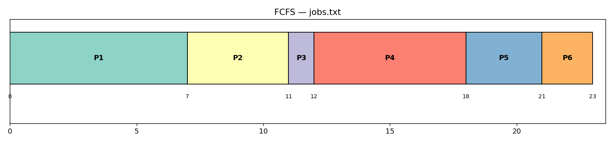
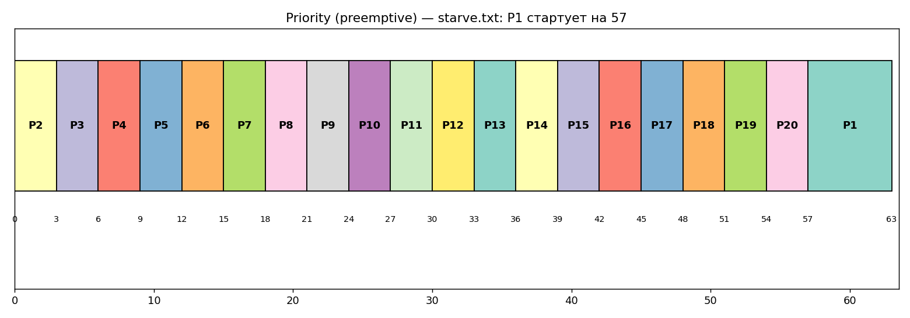
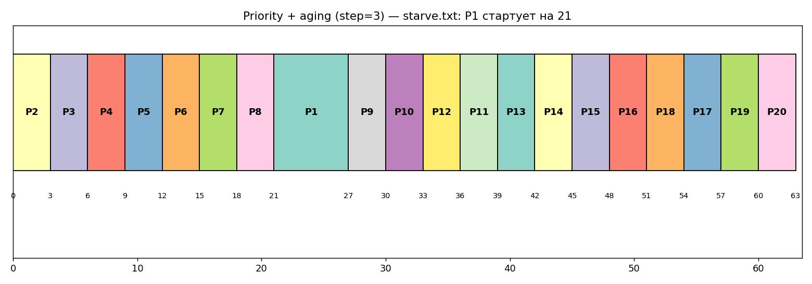

# Проект 1. Планировщик учебного сервера

**Проект №:** 1
**Участники (уровень / блок):**
| ФИО | Уровень | Блок / что сделал |
|---|---|---|
| Камыталиев Даниел | <уровень> | A (FCFS, SJF, RR, set1) |
| Эшанкулов Муса | <уровень> | B (SRTF, Priority, mixed, RR q=1..10, рекомендация) |
| Арсен Алмазов | <уровень> | C (starve, aging, MLFQ) |

## Запуск (одной командой на чистой Ubuntu, нужен только python3)
```
bash run.sh
```
Вывод команды сохраняется текстом в `output.txt`. PNG-диаграммы строятся, если установлен matplotlib (`sudo apt install python3-matplotlib`); без него скрипт всё равно работает, текстовые диаграммы Ганта — в `output.txt`.

Файлы: `scheduler.py` (симулятор), `run_all.py` (все таблицы), `make_gantt.py` (диаграммы), `check.py` (самопроверка), `run.sh` (запуск), `output.txt` (вывод команд).

**Соглашения (сверьте с ПР-5, при расхождении поменяйте в `scheduler.py`):** время дискретное (1 тик); меньше число приоритета = выше приоритет; при равенстве — раньше пришёл, затем меньший PID (у вытесняющих при полном равенстве продолжает текущий); в RR процесс, пришедший в момент t, встаёт в очередь *раньше* процесса, у которого в момент t закончился квант; «переключение» = смена исполняемого процесса на другой.
Метрики: ожидание = оборот − burst; оборот = завершение − приход; отклик = первый запуск − приход.

---
## Блок A. Базовый

### A1. Диаграмма Ганта FCFS, jobs.txt
(на бумаге перерисовать и сфотографировать — фото вставить сюда)

```
|P1       |P2     |P3|P4         |P5    |P6  |
0         7       11 12          18     21   23
```


| PID | приход | burst | старт | конец | ожидание | оборот |
|---|---|---|---|---|---|---|
| P1 | 0 | 7 | 0 | 7 | 0 | 7 |
| P2 | 2 | 4 | 7 | 11 | 5 | 9 |
| P3 | 3 | 1 | 11 | 12 | 8 | 9 |
| P4 | 5 | 6 | 12 | 18 | 7 | 13 |
| P5 | 6 | 3 | 18 | 21 | 12 | 15 |
| P6 | 8 | 2 | 21 | 23 | 13 | 15 |

Среднее ожидание = 45/6 = **7.50**, средний оборот = 68/6 = **11.33**.

### A2–A3. FCFS, SJF, RR q=2 (код `scheduler.py`)
Диаграммы:
- SJF: `|0-7:P1 |7-8:P3 |8-10:P6 |10-13:P5 |13-17:P2 |17-23:P4|`
- RR q=2: `|0-2:P1 |2-4:P2 |4-6:P1 |6-7:P3 |7-9:P2 |9-11:P4 |11-13:P5 |13-15:P1 |15-17:P6 |17-19:P4 |19-20:P5 |20-21:P1 |21-23:P4|`

Самопроверка на set1.txt (сверить с эталоном ПР-5):

| Алгоритм | ср. ожидание | ср. оборот |
|---|---|---|
| FCFS | 8.75 | 15.25 |
| SJF | 7.75 | 14.25 |
| RR q=2 | 12.75 | 19.25 |

FCFS на set1: `|0-8:P1 |8-12:P2 |12-21:P3 |21-26:P4|`. Если эталон отличается — проверьте соглашения (прежде всего очередь RR при одновременном приходе/окончании кванта).

### A4. Таблица для jobs.txt

| Алгоритм | ср. ожидание | ср. оборот | ср. отклик | перекл. |
|---|---|---|---|---|
| FCFS | 7.50 | 11.33 | 7.50 | 5 |
| **SJF** | **5.17** | **9.00** | 5.17 | 5 |
| RR q=2 | 8.33 | 12.17 | 3.17 | 12 |

**Лучший по ожиданию и обороту — SJF.** Он всегда берёт самый короткий готовый процесс, поэтому короткие P3 (1) и P6 (2) не ждут за длинными P1/P4; это минимизирует среднее ожидание (при отсутствии вытеснения). FCFS страдает от «эффекта конвоя» (P3 ждёт 8). RR хуже по ожиданию (все делят CPU, длинные растягиваются), но лучше по отклику (3.17 против 5.17–7.5) — это плата за 12 переключений вместо 5.

---
## Блок B. Основной

### B1–B2. Пять алгоритмов на mixed.txt (SRTF и Priority — вытесняющие)

| Алгоритм | ср. ожидание | ср. оборот | ср. отклик | переключ. | макс. ожидание |
|---|---|---|---|---|---|
| FCFS | 93.28 | 102.00 | 93.28 | 17 | 114 |
| SJF | 32.67 | 41.39 | 32.67 | 17 | 105 |
| RR q=2 | 30.83 | 39.56 | 8.61 | 76 | 106 |
| SRTF | 12.28 | 21.00 | 6.33 | 23 | 105 |
| Priority | 13.00 | 21.72 | 10.83 | 24 | 119 |

Короткие (15 шт.) vs длинные (P1, P3, P4):

| Алгоритм | ожидание коротких | отклик коротких | макс. ожид. коротких | ср. оборот длинных |
|---|---|---|---|---|
| FCFS | 104.67 | 104.67 | 114 | 76.33 |
| SJF | 27.27 | 27.27 | 47 | 99.67 |
| RR q=2 | 15.87 | 9.93 | 30 | 145.67 |
| SRTF | 0.47 | 0.47 | 3 | 111.33 |
| Priority | 0.53 | 0.40 | 3 | 115.33 |
| MLFQ | 7.00 | 0.20 | 21 | 148.33 |

### B3. RR на mixed.txt, квант 1…10

| q | ср. ожидание | ср. отклик | переключений |
|---|---|---|---|
| 1 | 29.78 | 4.39 | 145 |
| 2 | 30.83 | 8.61 | 76 |
| 3 | 33.28 | 12.33 | 57 |
| 4 | 32.50 | 15.78 | 42 |
| 5 | 35.61 | 19.39 | 36 |
| 6 | 37.39 | 21.33 | 33 |
| 7 | 41.11 | 24.78 | 31 |
| 8 | 42.78 | 26.44 | 29 |
| 9 | 45.89 | 29.83 | 28 |
| 10 | 47.00 | 31.33 | 26 |

Тренд: рост кванта ухудшает отклик и ожидание (RR вырождается в FCFS), но уменьшает число переключений (145 → 26). q=1 даёт лучшие ожидание/отклик, но 145 переключений — дорого на реальной системе. Разумный компромисс: **q=2** (отклик 8.6, 76 переключений) или q=4 (42 переключения, но отклик 15.8 — плохо для интерактивных).

### B4. Рекомендация заказчику
Требование: короткие запросы не ждут за длинными, но длинные когда-нибудь завершаются.
- FCFS — не подходит (короткие ждут в среднем 105 тиков).
- SRTF / Priority дают лучшие числа (ожидание коротких ≈ 0.5), **но** SRTF требует знать длительность заранее, а Priority/SRTF могут морить длинные задачи при непрерывном потоке коротких (см. блок C).
- **Рекомендация: MLFQ (3 уровня, кванты 2/4/8, периодический boost каждые 50 тиков).** Не требует знания burst; отклик коротких 0.2, ожидание коротких 7.0 (против 104.7 у FCFS и 15.9 у RR q=2); все 3 длинные задачи завершаются (до тика 157), boost гарантирует прогресс. Если нужен более простой вариант — **RR с q=2** (отклик 8.6; цена — 76 переключений).

---
## Блок C. Продвинутый

### C1. Голодание P1 в Priority (starve.txt)
P1 (приоритет 9, burst 6) пришёл в 0, но в каждый момент готов процесс с приоритетом выше (число меньше): P2 пришёл одновременно с P1, далее P3…P20 приходят каждые 3 тика и сразу занимают CPU. **P1 стартует только в тик 57 (после P20) и завершается в 63** (ожидание 57, отклик 57).


### C2. Старение (aging)
Правило: каждые `step` тиков ожидания в очереди готовых приоритет процесса улучшается на 1; пока процесс исполняется, накопленная льгота сохраняется, при вытеснении сбрасывается.

| step | P1 старт | P1 конец | ср. ожидание всех |
|---|---|---|---|
| без aging | 57 | 63 | 2.85 |
| 1 | 9 | 15 | 5.25 |
| 2 | 18 | 24 | 4.80 |
| **3** | **21** | **27** | **4.65** |
| 4 | 24 | 63* | 5.35 |
| 5 | 36 | 63* | 3.90 |
| 6 | 42 | 48 | 3.60 |
| 8 | 51 | 63* | 3.15 |
| 10 | 57 | 63 | 2.85 (aging не успевает: 9→1 = 80 тиков) |

\* P1 стартует раньше, но его вытесняют новые процессы с более высоким приоритетом.

При step=3 P1 стартует на **36 тиков раньше** (21 вместо 57) и завершается на 36 тиков раньше. Цена — рост среднего ожидания остальных (2.85 → 4.65): чем агрессивнее старение, тем ближе к FCFS.


### C3. MLFQ на mixed.txt
Параметры: 3 уровня, кванты 2/4/8; новый процесс → уровень 0; израсходовал квант → вниз; пришедший на более высоком уровне вытесняет текущего; каждые 50 тиков boost (все на уровень 0).

| Алгоритм | ср. ожидание | ср. оборот | ср. отклик | переключ. |
|---|---|---|---|---|
| SRTF | 12.28 | 21.00 | 6.33 | 23 |
| RR q=2 | 30.83 | 39.56 | 8.61 | 76 |
| RR q=4 | 32.50 | 41.22 | 15.78 | 42 |
| **MLFQ 2/4/8, boost 50** | 23.89 | 32.61 | **0.28** | 55 |
| MLFQ, boost 25 | 24.17 | 32.89 | 1.89 | 60 |
| MLFQ без boost | 24.78 | 33.50 | 0.28 | 47 |

Вывод: SRTF лучше по ожиданию/обороту, но это «оракул» (знает остаток). MLFQ без знаний о длительности приближается к нему: ожидание на 22% ниже, чем у RR q=2, отклик лучше всех, переключений меньше, чем у RR q=2 (55 против 76). Boost 50 даже слегка улучшил средние (24.78 → 23.89), более частый boost (25) чуть ухудшает отклик (1.89), но в любом случае гарантирует, что длинные не будут голодать.

### C4. Почему MLFQ работает без знания длительности
MLFQ *узнаёт* длительность по поведению. Каждый процесс начинает на верхнем уровне с малым квантом. Короткая/интерактивная задача успевает завершиться в рамках кванта и остаётся наверху (высокий приоритет и быстрый отклик — как у SJF/SRTF). Длинная задача исчерпывает квант и спускается вниз, где получает больший квант и меньший приоритет — т.е. система сама отделяет короткие от длинных по факту потреблённого CPU. Периодический boost возвращает всех наверх: это защищает от голодания и позволяет задаче, сменившей поведение (была CPU-bound, стала интерактивной), снова получить высокий приоритет.
